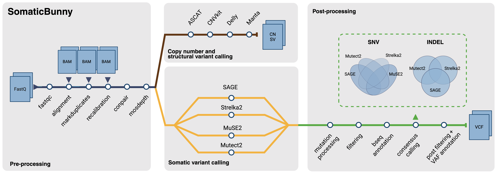

# SomaticBunny


**SomaticBunny** is an ensemble pipeline for somatic variant calling that integrates multiple tools to provide comprehensive variant detection in tumor-normal paired samples.

<br clear="left"/>


## Table of Contents
- [Overview](#overview)
- [Prerequisites](#prerequisites)
- [Installation](#installation)
- [Configuration](#configuration)
- [Usage](#usage)
  - [Basic Usage](#basic-usage)
  - [Choosing Where Jobs Run](#choosing-where-jobs-run)
  - [Custom Reference Genome](#custom-reference-genome)
  - [Advanced Options](#advanced-options)
- [Output](#output)
- [Tool Versions](#tool-versions)
- [Benchmark](#benchmark)
- [License](#license)

## Overview

The SomaticBunny pipeline integrates multiple variant calling tools to improve detection accuracy for:
- Single Nucleotide Variants (SNVs)
- Insertions and Deletions (INDELs)
- Structural Variants (SVs)
- Copy Number Variants (CNVs)

This pipeline is designed to work with paired tumor-normal whole-genome or whole-exome sequencing data.

<p align="center">
  
</p>


## Prerequisites

- Conda/Mamba for environment management
- A SLURM cluster is recommended for WGS data (see [Choosing Where Jobs Run](#choosing-where-jobs-run))

## Installation

1. Clone this repository

2. Install [Nextflow](https://www.nextflow.io/docs/latest/install.html) as a conda environment

3. Make sure you have the following required files in your working directory:
   - `main.nf`
   - `nextflow.config`
   - `conf/base.config`
   - `sample.csv`

4. Prepare your `sample.csv` file according to your analysis requirements:

   <details>
   <summary><b>For starting from fastq (click to expand)</b></summary>
   
   ```csv
   patient,sample,status,fastq_1,fastq_2
   UCSD101,A,normal,/PATH/TO/ERR5285401_1.fastq.gz,/PATH/TO/ERR5285401_2.fastq.gz
   UCSD101,A,tumor,/PATH/TO/ERR5285402_1.fastq.gz,/PATH/TO/ERR5285402_2.fastq.gz
   UCSD101,B,tumor,/PATH/TO/ERR5285403_1.fastq.gz,/PATH/TO/ERR5285403_2.fastq.gz
   ```
   </details>
   <details>
   <summary><b>For starting from bams (click to expand)</b></summary>
   
   ```csv
   patient,sample,status,bam,bai,sex
   UCSD101,A,normal,/PATH/TO/UCSD101_A_normal.bam,/PATH/TO/UCSD101_A_normal.bam.bai,XY
   UCSD101,A,tumor,/PATH/TO/UCSD101_A_tumor.bam,/PATH/TO/UCSD101_A_tumor.bam.bai,XY
   UCSD101,B,tumor,/PATH/TO/UCSD101_B_tumor.bam,/PATH/TO/UCSD101_B_tumor.bam.bai,XY
   ```
   </details>

   <details>
   <summary><b>For ASCAT analysis (click to expand)</b></summary>
   
   ```csv
   patient,sample,status,fastq_1,fastq_2,sex
   UCSD101,A,normal,/PATH/TO/ERR5285401_1.fastq.gz,/PATH/TO/ERR5285401_2.fastq.gz,XY
   UCSD101,A,tumor,/PATH/TO/ERR5285402_1.fastq.gz,/PATH/TO/ERR5285402_2.fastq.gz,XY
   UCSD101,B,tumor,/PATH/TO/ERR5285403_1.fastq.gz,/PATH/TO/ERR5285403_2.fastq.gz,XY
   ```
   </details>

  > [!NOTE]
  > **One FASTQ pair per sample.** Multi-lane libraries must be concatenated into one
  > `fastq_1`/`fastq_2` pair first (`cat` the lane files in the same order for R1 and R2); a
  > sample listed twice in `sample.csv` is refused at startup. Each BAM therefore carries one
  > read group (`ID`, `SM`, `LB` = `<patient>_<sample>_<status>`, `PL` = `ILLUMINA`, `PU` =
  > flowcell.lane of the first read), so BQSR fits one error profile per sample, not per lane.
  > Per-lane read groups are a known limitation of the input model.
  > bwa-mem2 runs with `-Y` and a fixed batch size `-K 160000000`, so alignments do not depend
  > on the number of CPUs assigned.


## Configuration

Everything the pipeline writes goes under the directory you launch it from, never under the pipeline code:

| What | Default | Change with |
|------|---------|-------------|
| Results | `<launch dir>/RESULTS` | `--outdir /path/to/results` |
| Run log (`pipeline.log`) | `<launch dir>/pipeline.log` | `--log_file /path/to/pipeline.log` |
| Nextflow work directory | `<launch dir>/work` | `-work-dir /path` (one dash, Nextflow option) or `workDir` in `nextflow.config` |
| MarkDuplicates temporary files | `<launch dir>/mkdup_tmp` | `--mkdup_temp_dir /path` |

The work directory and the MarkDuplicates temporary directory take the most space during a run; put them on a large scratch file system if your launch directory is on a small one.

## Usage

### Basic Usage

1. Request an interactive compute node (TSCC example; on another cluster, use your own partition and account):

```bash
srun -N 1 -n 1 -c 16 --mem 250G -t 80:00:00 -p platinum -q hcp-ddp302 -A ddp302 --pty bash
```

2. Activate your Nextflow environment:

```bash
conda activate env_nf
```

3. Set TSCC temporary directory and Nextflow tmp directory, and memory:

```bash
export TMPDIR=/path/to/restricted/folder/

export NXF_OPTS="-Djava.io.tmpdir=${TMPDIR} -Xms4g -Xmx16g"
```

4. Run the pipeline. This example runs a GRCh38 whole-genome tumor/normal pair from FASTQ on TSCC, with Manta and ASCAT in addition to the four SNV/INDEL callers:

```bash
nextflow run main.nf -profile tscc_slurm,conda \
    --type genome --genome GRCh38 --first_step mapping \
    --sample sample.csv \
    --database_path /path/to/SomaticBunny_database \
    --tool manta,ascat
```

`--type` is `genome` or `exome`; `--genome` is one of `GRCh38`, `GRCh37`, `mm39`, `RN7`; `--first_step` is
`mapping`, `markdup`, `recalibration` or `variant_calling` (tables below); `--tool` is optional and takes any
of `ascat`, `manta`, `delly`, `cnvkit`. The packaged reference of the genome is used unless a custom one is
given (see [Custom Reference Genome](#custom-reference-genome)). `-profile` chooses where jobs run (see
[Choosing Where Jobs Run](#choosing-where-jobs-run)): `slurm,conda` on another SLURM cluster, `conda` alone
to run locally.

#### Pipeline Steps and Tools

The SomaticBunny pipeline workflow is divided into multiple steps that can be run individually or in sequence using the `--first_step` parameter.

##### Available first_step

| First_step | Description | Required Input | 
|------|-------------| ---------------|
| `mapping` | This will start from performing alignment of FASTQ files to the reference genome | fastq_1 and fastq_2 |
| `markdup` | This will start from mark duplicate reads using the aligned BAM files | raw bam and bai |
| `recalibration` | This will start from performing base quality score recalibration (available for GRCh38 and GRCh37 only) | mark duplicated bam and bai |
| `variant_calling` | This will start from executing variant calling tools | recalibrated bam and bai |

##### Available reference genomes
| Genome | Status |
|--------|--------|
| GRCh38 | supported |
| GRCh37 | supported |
| mm39   | supported |
| RN7    | experimental: no Mutect2 panel of normals, never run end to end. Refused at startup unless `--allow_unvalidated_genome true` is given; Mutect2 then runs without `-pon`. |


> [!NOTE]
> **`--type genome` vs `--type exome`.** The SNV/INDEL callers are never restricted to exome
> targets, for either data type. Each caller runs on its own call space (Mutect2: the scattered
> interval lists, chr1-22, X, Y, M; Strelka2: `--callRegions` with `--bed`, chr1-22, X, Y; SAGE:
> its built-in chr1-22, X, Y; MuSE: the whole reference). The consensus step
> (`consensus_scenarios.sh`) then applies one region set to all four callers identically: by
> default the primary chromosomes chr1-22, X, Y, or the regions given with `--consensus_contigs`
> / `--callable_bed`. Variants outside that set never enter any scenario; they are counted in the
> POST_SCENARIOS task log and listed in `special_mutations/<sample>_outside_callable_regions.tsv`.
> `--type exome` only switches Strelka2 and Manta to `--exome` mode (depth filters off), MuSE to
> `-E`, base quality score recalibration to the exome interval list, and mosdepth, CNVkit and
> ASCAT to their exome resources. To restrict a WES consensus to the capture targets, pass the
> kit's BED as `--callable_bed`: it is applied after calling, so every caller is filtered the
> same way.

| Parameter | Description | Default |
|-----------|-------------|---------|
| `--consensus_contigs` | Contigs allowed into the consensus: comma list or a file with one name per line | primary chromosomes of the genome |
| `--callable_bed` | BED of callable regions applied to all callers at the consensus step (e.g. WES capture targets) | none |

> [!NOTE]
> **SAGE runs outside the Hartwig workflow.** SAGE 4.2 (HMF resources 2.3.0--2) is run on the same
> BAMs as the other callers (bwa-mem2, Picard MarkDuplicates, GATK BQSR), not on REDUX output. With no
> sample-specific jitter/MSI model it runs with `-skip_msi_jitter`, i.e. default jitter parameters, so
> microsatellite indel filtering is not calibrated to the sample. SAGE is one of the four consensus
> callers only. Jar and resource hashes: `checksums/database_files.sha256` and the top of every SAGE log.

##### Available Tools

Use the `--tool` parameter to specify which variant callers to run. You can select multiple tools by separating them with commas.

| Category | Available Tools | Description |
|----------|----------------|-------------|
| SV Callers | `manta` | Structural variant and indel caller |
| | `delly` | Integrated structural variant detection |
| CNV Callers | `ascat` | Allele-specific copy number analysis (requires sex information) |
| | `cnvkit` | Copy number variation detection from targeted DNA sequencing |

Example of running multiple tools:
```bash
# Run Manta for SVs and ASCAT for CNVs
nextflow run main.nf -profile tscc_slurm,conda --genome GRCh38 --type genome --first_step mapping --tool manta,ascat
```

### Choosing Where Jobs Run

Use `-profile` (one dash, it is a Nextflow option) to choose the scheduler, combined with `conda` for the software. Profiles are separated by a comma, with no space.

| Profile | Runs on |
|---------|---------|
| `tscc_slurm,conda` | UCSD TSCC: each job is submitted to SLURM with the lab's partition, QoS and account |
| `slurm,conda` | Any SLURM cluster: each job is submitted to SLURM with the cluster's defaults, or with your own options (see below) |
| `conda` | The current machine only (no scheduler) |

> [!WARNING]
> Without `tscc_slurm` or `slurm`, all jobs run on the machine where Nextflow is started, which is not practical for WGS data.

#### Running on other SLURM clusters

If your cluster needs a partition, account or QoS, put them in a small config file of your own and pass it with `-c`. You don't need to edit SomaticBunny's `nextflow.config`, so your settings are kept when you update the pipeline.

1. Create `my_cluster.config` (any name works):

```groovy
// my_cluster.config
process.clusterOptions = '-p <partition> -A <account>'
```

2. Run with the `slurm` profile and your config:

```bash
nextflow run main.nf -profile slurm,conda -c my_cluster.config --type genome ...
```

`process.clusterOptions` is passed to every job as extra `sbatch` options, so anything `sbatch` accepts works, e.g. `'--partition=compute --account=mylab --qos=normal'`.

If your nodes are smaller than the default requests (up to 16 CPUs and 250 GB for some steps), cap what any job can request:

```bash
nextflow run main.nf -profile slurm,conda -c my_cluster.config --max_cpus 32 --max_memory 192.GB --max_time 72.h ...
```

#### Software

SomaticBunny installs its tools with Conda (`-profile conda`, or `-profile mamba` for faster environment creation). Container engines such as Docker and Singularity are not supported.

### Database

`--database_path` points at the SomaticBunny database: references and indexes, caller resources, and
the third-party programs the pipeline runs outside Conda (GATK 4.6.2.0, SAGE 4.2 with the HMF
resources, Conpair 0.2, the DKFZ bias filter). `checksums/components.tsv` lists every component with
its version, source and license, and `checksums/database_files.sha256` holds the SHA256 of every file.
At startup the pipeline checks that every manifest file is present; after installing or updating the
database, verify the content once with

    bash bin/verify_database.sh /path/to/SomaticBunny_database --hash

`--verify_database hash` does the same at startup; `--verify_database none` skips the check.

### Custom Reference Genome

When starting the pipeline from BAM files (`--first_step markdup`, `recalibration`, or `variant_calling`), you **must** provide your own reference genome files. This is because BAM files are already aligned to a specific reference, and the pipeline needs the matching reference for downstream analysis.

#### Required parameters

| Parameter | Description | Example |
|-----------|-------------|---------|
| `--ref` | Reference FASTA file | `/path/to/hg38_genome.fa` |
| `--ref_fai` | FASTA index file | `/path/to/hg38_genome.fa.fai` |
| `--ref_dict` | Sequence dictionary | `/path/to/hg38_genome.dict` |
| `--bed` | BED of the chromosomes to call, whole contigs (bgzipped). Used by Strelka2 `--callRegions`; not an exome target BED, see the `--type` note | `/path/to/hg38_chr.bed.gz` |
| `--bed_tbi` | Tabix index for the BED file | `/path/to/callable_regions.bed.gz.tbi` |

All five files must be provided together. The pipeline will exit with an error if any are missing.

#### Example

```bash
nextflow run main.nf \
  -profile tscc_slurm,conda \
  --type genome \
  --genome GRCh38 \
  --first_step variant_calling \
  --sample sample.csv \
  --database_path /path/to/SomaticBunny_database \
  --ref /path/to/hg38_genome.fa \
  --ref_fai /path/to/hg38_genome.fa.fai \
  --ref_dict /path/to/hg38_genome.dict \
  --bed /path/to/hg38_genome_callable_regions.bed.gz \
  --bed_tbi /path/to/hg38_genome_callable_regions.bed.gz.tbi
```

When a custom reference is provided, the pipeline will automatically generate the scattered interval lists required by GATK tools (Mutect2, BaseRecalibrator, etc.) from your reference. When starting from `mapping`, these parameters are optional and will fall back to the pipeline's built-in defaults for the selected `--genome`.

> [!IMPORTANT]
> **A custom reference must match the packaged resources of the selected `--genome`.** At startup the
> pipeline compares the contig names and lengths of every packaged resource the run will use (Mutect2
> germline and panel of normals, MuSE dbSNP, BQSR known sites, SAGE and Conpair files, exome BEDs,
> Delly exclude list, ASCAT loci) with `--ref_fai`; `--ref_dict` must list exactly the reference
> contigs. Any mismatch stops the run before a job is submitted. Either supply matching resources
> through the corresponding `--<resource>` options (for example `--mutect2_germline`,
> `--SAGE_panel_bed`, `--ascat_loci_prefix`) or leave the tool out of `--tool`. The packaged
> resources use `chr`-prefixed contig names; GRCh38 builds that differ only in alt, decoy or HLA
> contigs pass.

### Advanced Options

#### Publishing Intermediate Files

By default, intermediate files are not saved to reduce disk usage. Use the `--publish` parameter to save specific file types:

```bash
nextflow run main.nf -profile tscc_slurm,conda --type genome --genome GRCh38 --first_step mapping --publish raw_bam,markdup_bam
```

**Available options:**
- `raw_bam`: Publish raw BAM files from BWA-MEM
- `markdup_bam`: Publish mark duplicates BAM files
- `recal_bam`: Publish recalibrated BAM files

#### Resuming Failed Runs

If your pipeline terminates with an error or the interactive node is killed, resume with:

```bash
nextflow run main.nf -profile tscc_slurm,conda --type genome --genome GRCh38 --first_step mapping --tool ascat,manta -resume
```

#### Email Notifications

Receive completion notification:

```bash
nextflow run main.nf -profile tscc_slurm,conda --type genome --genome GRCh38 --first_step mapping --tool ascat,manta -N your_email@example.com
```

#### Optical duplicate distance

`--mkdup_optical_pixel_distance` sets Picard MarkDuplicates `OPTICAL_DUPLICATE_PIXEL_DISTANCE`.
Default `100` (Picard's default, right for unpatterned flow cells such as HiSeq 2000/2500, and the
setting used for the benchmark); use `2500` for patterned flow cells (HiSeq X, HiSeq 4000, NovaSeq).
The value affects only the duplicate metrics (optical duplicate count and estimated library size),
not which reads are flagged as duplicates, so variant calls are unchanged.

## Output

All results and reports are stored under `--outdir` (default: `RESULTS` in the directory you launch the pipeline from) with the following structure:

```
RESULTS/
├── ASCAT (optional)
├── BAM (optional)
├── CNVkit (optional)
├── Conpair
├── Delly (optional)
├── FASTQC
├── MANTA (optional)
├── MKDUP
├── mosdepth
├── MuSE
├── Mutect2
├── POST
│   ├── <patient>_<sample>/scenario1 ... scenario_6   consensus SNV and INDEL calls per scenario
│   └── VAF                                           allele counts and VAFs for the scenario 4-6 consensus calls
├── RECALIBRATE (optional)
├── REPORT
├── pipeline_info/params_<timestamp>.json   resolved parameters of the run
├── SAGE
└── STRELKA
```

### Variant allele fractions (`RESULTS/POST/VAF`)

For each tumor sample and each of scenarios 4, 5 and 6, the pipeline writes
`<patient>_<sample>_<scenario>_VAF.tsv`: one row per consensus variant, 21 fixed
tab-separated columns, header without `#`, so it loads directly into pandas or R.

| Column | Content |
|--------|---------|
| `sample` | `<patient>_<sample>_<scenario>` |
| `CHROM`, `POS`, `ID`, `REF`, `ALT` | as in the consensus VCF |
| `TYPE` | `SNV`, `INDEL`, `MNP`, `MULTIALLELIC` or `INVALID` |
| `FILTER` | consensus FILTER (`PASS`, `OnePassCaller`, `NoPassCaller`) |
| `CALLERS`, `PASS_CALLERS`, `CALLER_FILTERS` | callers that reported the variant, those that passed, and each caller's filter value |
| `TUMOR_REF`, `TUMOR_ALT`, `TUMOR_DEPTH`, `TUMOR_VAF` | tumor counts and `ALT / DEPTH` |
| `NORMAL_REF`, `NORMAL_ALT`, `NORMAL_DEPTH`, `NORMAL_VAF` | the same for the matched normal |
| `STATUS` | `OK`, `NO_COVERAGE` (depth 0 in tumor or normal), or why counts are `NA` (`MNP`, `MULTIALLELIC`, `INVALID`) |
| `NORMALIZED` | `.`, or `POS:REF>ALT` of the left-aligned indel that was counted when it differs from the VCF record |

SNV counts come from alleleCounter (base quality >= 20, mapping quality >= 35); depth is
alleleCounter's `Good_depth`. INDEL counts are taken from the BAMs with the same thresholds:
a read supports `ALT` only if it carries exactly the called event after left-normalisation,
supports `REF` only if it is aligned without any indel across the event, and is otherwise
excluded; depth is `REF + ALT`. The raw alleleCounter outputs
(`*_tumor_alleleCounter.txt`, `*_normal_alleleCounter.txt`) are kept next to the table.

## Tool Versions

| Category | Tool | Version |
|----------|------|---------|
| QC | FastQC | v0.12.1 |
| Data Processing | Picard | v3.4.0 |
| | samtools | v1.24 |
| | bwa-mem2 | v2.3 |
| | Conpair | v0.2 |
| | GATK4 | v4.6.2.0 |
| | mosdepth | v0.3.14 |
| SNV/INDEL Callers | Strelka2 | v2.9.10 |
| | Mutect2 | v4.6.2.0 |
| | SAGE | v4.2 with HMF pipeline resources 2.3.0--2 (SomaticBunny BAMs, no REDUX, -skip_msi_jitter) |
| | MuSE2 | v2.1.2 |
| Structural Variants | Delly | v2.6.0 |
| | Manta | v1.6.0 |
| Copy Number Variants | CNVkit | v0.9.13 |
| | ASCAT | v3.2.0 |

## Benchmark

Code to reproduce the benchmark against nf-core/sarek is in [`Benchmark/`](Benchmark).

## License

SomaticBunny is released under the BSD 2-Clause License (see [`LICENSE.txt`](LICENSE.txt)).
The tools it runs (GATK, Strelka2, SAGE, MuSE, Manta, Delly, ASCAT, CNVkit, Conpair, ...) are
installed by Conda and keep their own licenses.
